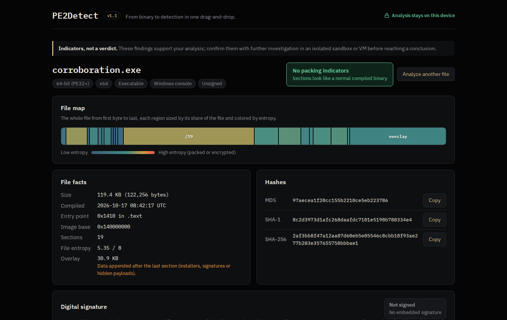
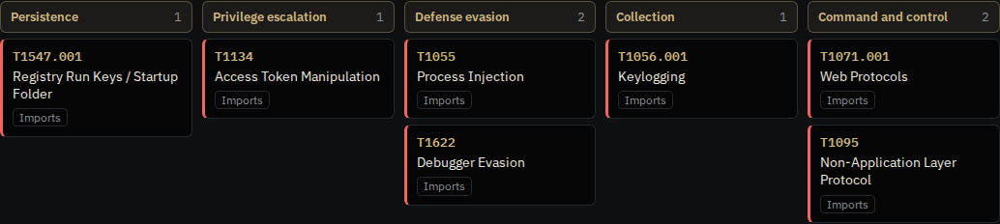
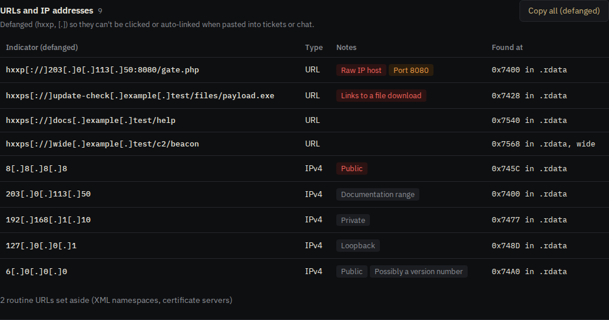
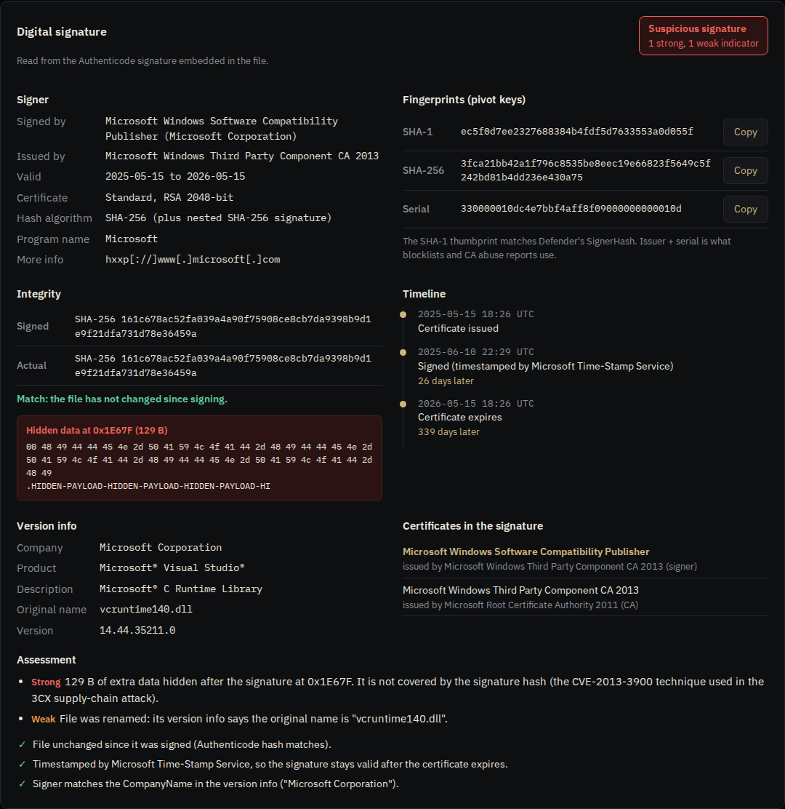

# PE2Detect v1.1

**From binary to detection in one drag-and-drop.**

PE2Detect is a browser-based analyzer for Windows executables (`.exe` and `.dll`), built for SOC and malware analysts. Drop a file onto the page and it shows what the file is, what it can do, how that maps to MITRE ATT&CK®, and whether its digital signature can be trusted, in plain English.

It is a single self-contained HTML file. There is nothing to install, no server, and **the analyzed file never leaves your machine**.

> **Important**
> - **An independent reference project**, built on general malware analysis knowledge and publicly documented techniques. PE2Detect highlights indicators that can help an analysis. Use it as a reference, but do not rely on it alone for a final verdict: confirm findings with further investigation.
> - **Use a sandbox or VM.** PE2Detect reads files and never executes them, but the files themselves can be dangerous. Handle and analyze suspicious files only inside an isolated sandbox or virtual machine.
> - Not affiliated with any employer. Built independently from public information.

## Try it

- **Online:** open the GitHub Pages version at `https://abhishek-chougule321.github.io/pe2detect/`
- **Offline:** download `index.html` from the latest release (v1.1) and open it in Chrome, Edge or Firefox. It works without an internet connection.

Files up to **100 MB** are supported, one file at a time.

## Features

**File basics.** MD5, SHA-1 and SHA-256 hashes, file size, compile timestamp (with checks for zeroed, future or forged values), entry point, image base and overlay detection.

**Sections and packing.** Every section with its permissions and Shannon entropy, a file map colored by entropy, and a packing assessment that combines independent indicators: packer section names, high entropy, writable-and-executable sections, sections that are empty on disk but executable in memory, unusual entry points and tiny import tables. Each indicator is graded strong or weak.

**Imports and capabilities.** The full import table (including imports by ordinal), with suspicious APIs flagged. Imports are grouped into capabilities such as process injection, keylogging, credential theft and command-and-control, each mapped to an ATT&CK technique. A capability is a recipe of steps, so a single common API does not trigger an alert on its own.

**Strings.** ASCII and UTF-16 ("wide") string extraction, matched against behavior-based rules: shadow-copy deletion, Run-key persistence, encoded PowerShell, Defender tampering, browser credential paths, Tor addresses, Telegram bots, mining pools and more. When a string backs up an import-based capability, the capability is marked as corroborated.

**Network indicators.** URLs and IPv4 addresses from the strings, shown **defanged** (`hxxps[://]example[.]com`) so they cannot be clicked or auto-linked when pasted into a ticket. IPs are classified (public, private, loopback, documentation range), and routine values such as XML namespace URLs and version numbers (including the file's own version) are set aside.

**Digital signature.** The embedded Authenticode signature is parsed in the browser: signer, issuer, validity, certificate type (including EV), SHA-1 and SHA-256 thumbprints, serial number, timestamp authority and nested signatures. PE2Detect recomputes the Authenticode hash to detect files modified after signing, and detects data hidden after the signature (the CVE-2013-3900 technique used in the 3CX supply-chain attack). It then checks the timeline (certificate issued, compiled, signed, expires) and whether the signer matches what the file's version info claims to be.

## Privacy and security

A suspicious file cannot run, and cannot use PE2Detect to run code, for these layered reasons:

- **Read, never run.** Files are read as raw bytes with the browser's File API and processed with typed arrays. A web page has no way to execute a Windows program, and PE2Detect never saves, downloads or opens the file; dropping a file onto the page never makes the browser open or download it.
- **No file content is ever treated as code.** File names, section names, imports, strings, version info and certificate fields can all be controlled by an attacker, so every value is HTML-escaped before display. There is no `eval`, no dynamic code, no iframes and no object URLs.
- **Only the tool's own script may run.** The Content Security Policy is pinned to the SHA-256 hash of PE2Detect's script. Even if a crafted file managed to inject markup, the browser would refuse to run any other script or event handler.
- **No network access.** The policy also sets `connect-src 'none'` and blocks remote scripts, images and fonts (the fonts are embedded), so nothing can be sent anywhere. Verify it in one line at the top of `index.html`, or in the browser's network tab.
- **Robust parsing.** Every parser has bounds checks and loop limits, version-info fields are stored in an object with no prototype (so names like `__proto__` are just data), and files larger than 100 MB are refused to protect the browser tab.
- **Tested against attacks.** The test suite builds a hostile file carrying script-injection payloads in its strings, imports, section names, version info, certificate names and file name, and confirms none of them run, whether the file is chosen or dropped.

**Editing the script?** Run `python3 tools/update_csp_hash.py` afterwards. It updates the pinned hash; without it, the browser refuses the edited script and the page stops working (`tests/verify.py` also catches this).

## How it works

The code in `index.html` is organized in commented parts that follow the order of the analysis:

| Part | What it does |
|---|---|
| 1. Loading | Reads the dropped file into memory with the File API |
| 2. Hashes | SHA-1 and SHA-256 via Web Crypto; MD5 implemented from RFC 1321, because Web Crypto omits it |
| 3. PE parsing | DOS header, PE signature, COFF and optional headers, data directories, section table |
| 3b. Imports | Translates RVAs to file offsets and walks the import descriptors and thunks |
| 3c. Strings | Extracts ASCII and UTF-16LE strings with their offsets and sections |
| 3d. Signature | A small ASN.1 DER reader, PKCS#7 and Authenticode parsing, timestamps, the Authenticode hash |
| 3e. Version info | Walks the resource tree to the VERSIONINFO block |
| 4. Assessment | Timestamp checks, entropy, packing indicators |
| 4b to 4f | Capability recipes, string rules, network indicators, the ATT&CK matrix, signer assessment |
| 5. Rendering | Builds the report, escaping every value that came from the file |

## How it was tested

`tests/` contains the source of every test file plus scripts that build them and compare PE2Detect's output with independent tools:

- **Import tables** match [pefile](https://github.com/erocarrera/pefile) exactly, for 32-bit, 64-bit, packed and real-world files.
- **String counts** match GNU `strings` for both ASCII and wide strings.
- **Signature parsing** (signed hash, thumbprint, serial) matches [signify](https://github.com/ralphje/signify) on self-made and genuinely signed files.
- **Expected findings** are checked for each test file: injection, packing, ransomware strings, defanged indicators, impersonation, tampering, hidden data after the signature and more.
- **Privacy:** the page makes no network requests, and an exfiltration attempt from inside the page is blocked.
- **Security:** a hostile file full of script-injection payloads never runs code, via the file picker or drag-and-drop, and the policy blocks injected event handlers.
- **Robustness:** corrupted headers and signatures never crash the page.

See [`tests/README.md`](tests/README.md) to run the suite yourself. The repository contains no binaries, private keys or malware; everything is built locally.

## Limitations

- **Static analysis only.** Packed or obfuscated files hide their real imports and strings until they run. PE2Detect warns when a file looks packed, but dynamic analysis is the next step for those.
- **Capabilities are not intent.** Imports and strings show what a file can do. Legitimate software often has some of the same capabilities.
- **Signature trust is not fully verified.** PE2Detect does not check whether Windows trusts the certificate chain, whether the certificate has been revoked, or the signer's cryptographic signature itself. Confirm on Windows with `signtool verify /pa /v` or `sigcheck -i`.
- **Rules are public.** Like any open-source detection logic, the rules can be read and evaded. They are one layer of evidence, not a verdict.

## Roadmap

- YARA rule and KQL hunting query generation (Microsoft Sentinel and Defender)
- Import of capa JSON results as an additional evidence source
- Optional online enrichment (signer reputation, VirusTotal and MalwareBazaar lookups by hash)
- Markdown analyst report export

## Disclaimer

PE2Detect is an independent project, provided for reference only and built on general malware analysis knowledge and publicly documented techniques. It highlights indicators that can support an analysis; it is not antivirus software, and its results must not be relied on alone for a final verdict. Its findings are heuristics and can be wrong in both directions.

Perform all malware analysis, including handling the files you load into PE2Detect, only inside an isolated sandbox or virtual machine.

The software is provided as is, without warranty of any kind; see [LICENSE](LICENSE). It is not affiliated with, or endorsed by, any employer.

## References

PE2Detect is built entirely from public specifications and published security knowledge:

- Microsoft, *PE Format* (Microsoft Learn): headers, sections, imports, resources
- Microsoft, *Windows Authenticode Portable Executable Signature Format*
- Microsoft, *VS_VERSIONINFO* and Win32 API documentation (Microsoft Learn)
- Microsoft Security Advisory for CVE-2013-3900 (WinVerifyTrust signature validation)
- RFC 1321 (MD5), RFC 5652 (CMS / PKCS#7), RFC 5280 (X.509), RFC 3161 (timestamps), ITU-T X.690 (DER)
- RFC 1918, RFC 5737, RFC 6598, RFC 3927 (special-purpose IPv4 ranges)
- CA/Browser Forum, EV Code Signing Guidelines (OID 2.23.140.1.3)
- MITRE ATT&CK® (techniques, tactics, procedure examples)
- LOLBAS project (living-off-the-land binaries)
- Mandiant capa (capability-detection approach, for comparison)
- CyberChef (defanging convention)

## Acknowledgments and notices

This project makes use of MITRE ATT&CK®. © 2026 The MITRE Corporation. This work is reproduced and distributed with the permission of The MITRE Corporation. ATT&CK® is a registered trademark of The MITRE Corporation. See the [ATT&CK Terms of Use](https://attack.mitre.org/resources/legal-and-branding/terms-of-use/).

Fonts: IBM Plex Sans and IBM Plex Mono, © 2019 IBM Corp., licensed under the SIL Open Font License 1.1. Details and other third-party notices are in [THIRD_PARTY_NOTICES.md](THIRD_PARTY_NOTICES.md).

Product and company names mentioned in the tool and this README are used only to describe what PE2Detect detects. They are trademarks of their respective owners, who do not endorse this project.

## License

[MIT](LICENSE) © 2026 The PE2Detect contributors
